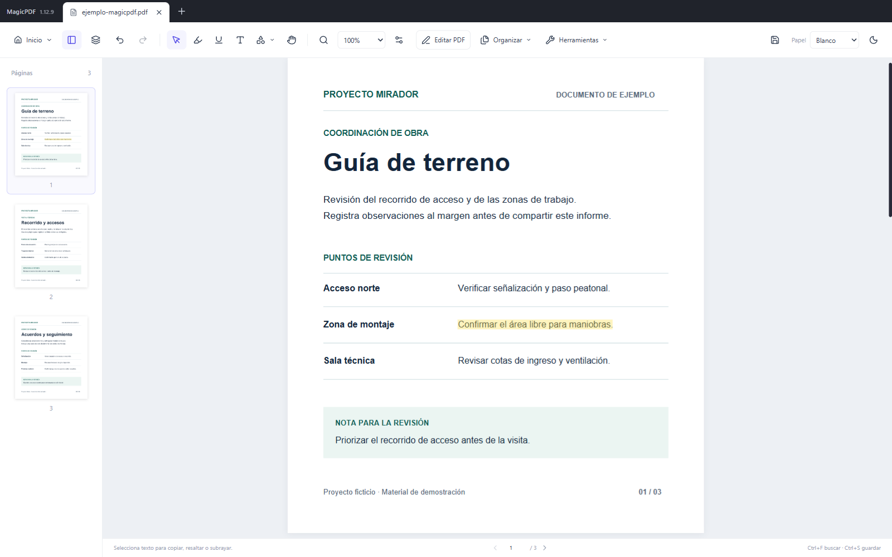
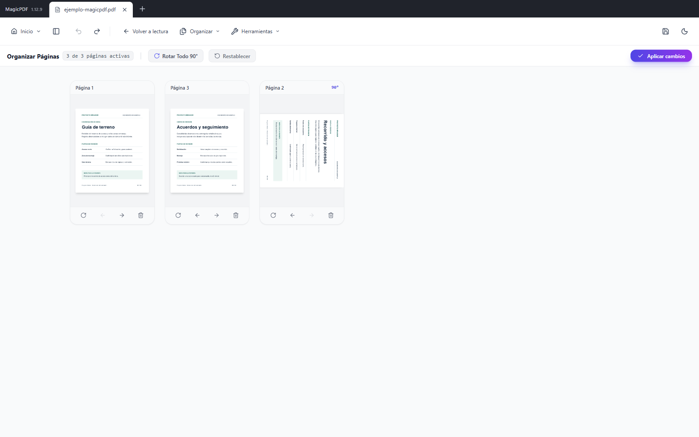

# MagicPDF Pro

Lee, anota y organiza PDF en Windows. Puedes convertir un escaneo en texto seleccionable en español o inglés, incluso sin conexión. Tus documentos se procesan en tu equipo.

[Guía de uso](docs/GUIA.md) · [PDF de ejemplo](docs/ejemplo-magicpdf.pdf) · [Privacidad](docs/PRIVACIDAD.md) · [Reportar un problema](https://github.com/matfigueroac/MagicPDF/issues)


## Instalar en Windows

1. Abre [Versiones de MagicPDF](https://github.com/matfigueroac/MagicPDF/releases) y descarga el archivo **MagicPDF-Pro-Setup-…exe** para Windows x64.
2. El instalador de GitHub se distribuye sin firma Authenticode y Windows puede mostrar un aviso de SmartScreen. Puedes comprobar el archivo con PowerShell mediante `Get-FileHash .\MagicPDF-Pro-Setup-1.12.5.exe -Algorithm SHA256` y comparar el resultado con el archivo **SHA256SUMS.txt** de esa versión. [Información de Microsoft sobre SmartScreen](https://learn.microsoft.com/windows/apps/package-and-deploy/smartscreen-reputation)
3. Ejecuta el instalador y abre **MagicPDF Pro** desde Inicio. Desde la versión 1.12.5, usa **Inicio → Buscar actualizaciones…** para descargar una versión posterior. MagicPDF verifica el SHA-256 publicado en GitHub. Guarda tus PDF y cierra la aplicación antes de abrir el nuevo instalador.

También puedes instalar MagicPDF Pro gratis desde Microsoft Store en Windows x64. La tienda gestiona las actualizaciones de esta edición. [Microsoft Store](https://apps.microsoft.com/detail/9N3RHFGLFV4V)

## Prueba MagicPDF con un documento de ejemplo

1. Descarga el [informe de ejemplo](docs/ejemplo-magicpdf.pdf) y ábrelo con **Ctrl+O**.
2. Selecciona una frase y pulsa **Resaltar**. Abre **Organizar páginas** para cambiar el orden o girar una página.
3. Elige **Inicio → Guardar como…** para guardar el resultado en otro archivo.

| Anotar | Organizar | Exportar texto |
| --- | --- | --- |
| [](docs/images/store/resaltar.png) | [](docs/images/store/organizar.png) | [](docs/images/store/exportar-texto.png) |
| Resalta, subraya y añade notas o dibujos. | Reordena, gira, combina o divide páginas. | Copia el texto o guárdalo como TXT. |

Para trabajar con un PDF escaneado, abre **Herramientas → OCR local**. Los idiomas español e inglés vienen incluidos. Puedes buscar el texto reconocido con **Ctrl+F** o exportarlo como TXT.

## Ejecutar desde el código

En Windows x64, con Git y Node.js 24 instalados, abre PowerShell y ejecuta:

```powershell
git clone https://github.com/matfigueroac/MagicPDF.git
cd MagicPDF
npm ci
npm run build
npm run app
```

Para generar tu propio instalador de prueba, ejecuta `npm run dist:release`. El instalador y su suma SHA-256 se guardan en `release/`. [Compilación, firma y actualizaciones](docs/RELEASE.md)

## Licencia

El código de MagicPDF se distribuye bajo la licencia MIT. Las bibliotecas, los modelos de OCR y el motor PDFCraft conservan sus propias licencias. Encontrarás **Licencias-de-terceros.txt** en cada descarga de Windows y dentro de la aplicación instalada. [Licencia MIT](LICENSE) · [Descargas y avisos](https://github.com/matfigueroac/MagicPDF/releases) · [Avisos de PDFCraft](bin/licenses)
