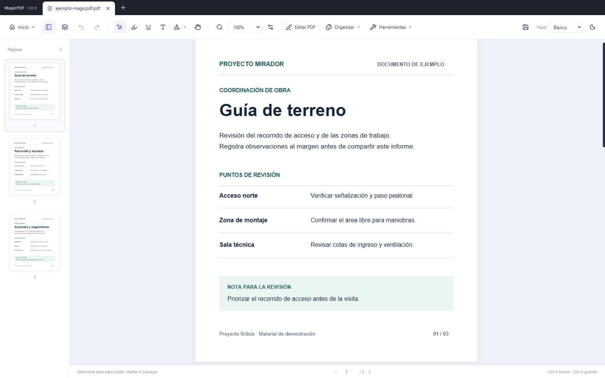
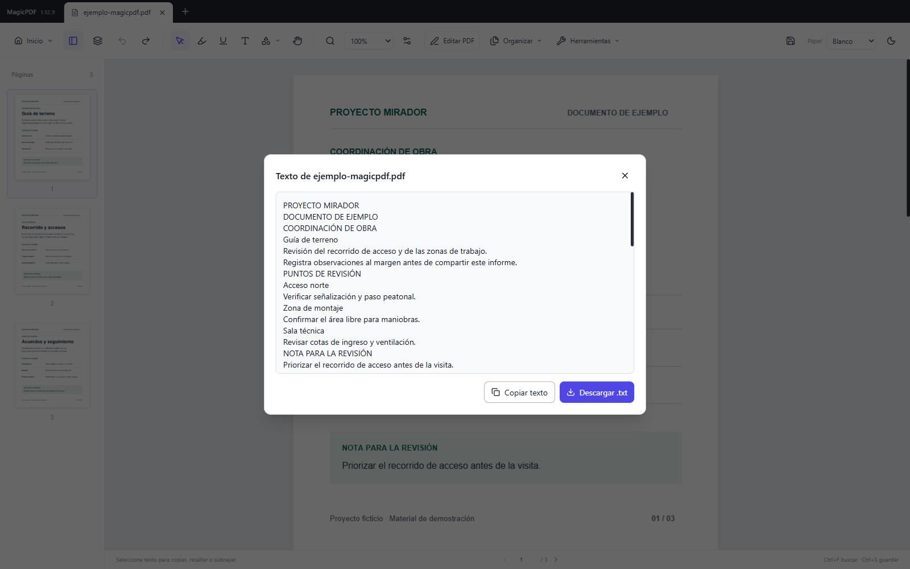

# MagicPDF Pro

Lee, anota y organiza PDF en Windows. Puedes convertir un escaneo en texto seleccionable en español o inglés, incluso sin conexión. Tus documentos se procesan en tu equipo.

[Guía de uso](docs/GUIA.md) · [PDF de ejemplo](docs/ejemplo-magicpdf.pdf) · [Privacidad](docs/PRIVACIDAD.md) · [Reportar un problema](https://github.com/matfigueroac/MagicPDF/issues)



## Instalar en Windows

1. Descarga el [instalador preliminar de MagicPDF Pro 1.12.4 para Windows x64](https://github.com/matfigueroac/MagicPDF/releases/download/v1.12.4-preview.1/MagicPDF-Pro-Setup-1.12.4.exe).
2. Esta edición se distribuye sin firma de producción. Para comprobar la descarga, ejecuta `Get-FileHash .\MagicPDF-Pro-Setup-1.12.4.exe` en PowerShell y compara el resultado con el [SHA-256 publicado](https://github.com/matfigueroac/MagicPDF/releases/download/v1.12.4-preview.1/SHA256SUMS.txt).
3. Ejecuta el instalador y abre **MagicPDF Pro** desde el menú Inicio. Las actualizaciones de la edición preliminar se instalan manualmente desde [Versiones](https://github.com/matfigueroac/MagicPDF/releases).

La edición para Microsoft Store está en certificación. Cuando esté publicada, podrás instalarla desde la ficha de MagicPDF Pro y recibir actualizaciones a través de la tienda. [Microsoft Store](https://apps.microsoft.com/detail/9N3RHFGLFV4V)

## Prueba MagicPDF con un documento de ejemplo

1. Descarga el [informe de ejemplo](docs/ejemplo-magicpdf.pdf) y ábrelo con **Ctrl+O**.
2. Selecciona una frase y pulsa **Resaltar**. Abre **Organizar páginas** para cambiar el orden o girar una página.
3. Elige **Inicio → Guardar como…** para guardar el resultado en otro archivo.

| Anotar | Organizar | Exportar texto |
| --- | --- | --- |
| [](docs/images/store/resaltar.png) | [](docs/images/store/organizar.png) | [](docs/images/store/exportar-texto.png) |
| Resalta, subraya y añade notas o dibujos. | Reordena, gira, combina o divide páginas. | Copia el texto o guárdalo como TXT. |

Para trabajar con un PDF escaneado, abre **Herramientas → OCR local**. Los idiomas español e inglés vienen incluidos. Puedes buscar el texto reconocido con **Ctrl+F** o exportarlo como TXT.

## Ejecutar desde el código

En Windows x64, con Git y Node.js 24 instalados, abre PowerShell y ejecuta:

```powershell
git clone https://github.com/matfigueroac/MagicPDF.git
cd MagicPDF
npm ci
npm run build
npm run app
```

Para generar tu propio instalador de prueba, ejecuta `npm run dist:release`. El instalador y su suma SHA-256 se guardan en `release/`. [Compilación, firma y actualizaciones](docs/RELEASE.md)

## Licencia

El código de MagicPDF se distribuye bajo la licencia MIT. Las bibliotecas, los modelos de OCR y el motor PDFCraft conservan sus propias licencias. Consulta los avisos distribuidos con el instalador. [Licencia MIT](LICENSE) · [Licencias de terceros](https://github.com/matfigueroac/MagicPDF/releases/download/v1.12.4-preview.1/Licencias-de-terceros.txt) · [Avisos de PDFCraft](bin/licenses)
